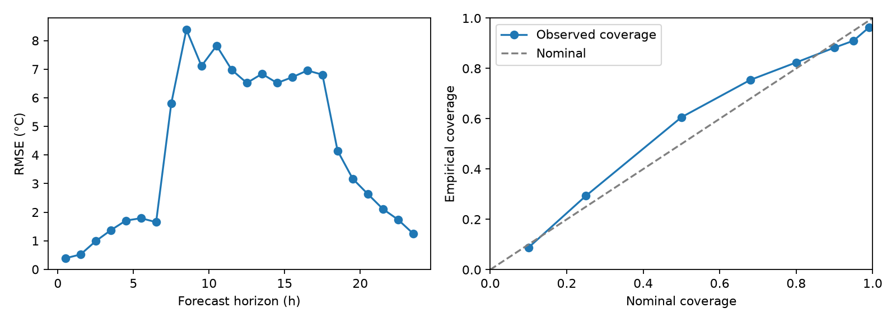
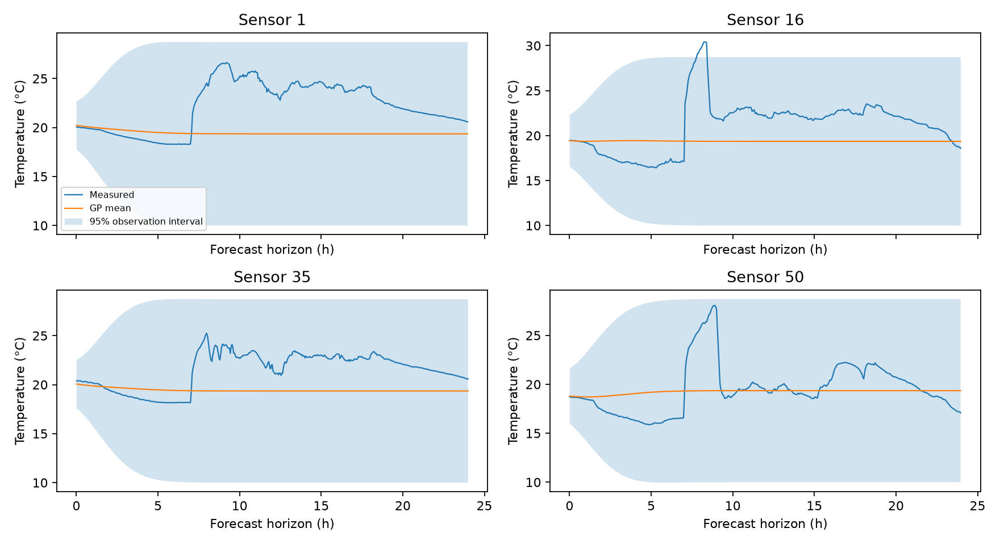

# Intel Lab: three-day history and fourth-day forecast

## Data and method

[Intel Lab repository](https://github.com/linsea423/Intel_Lab_Data); [original dataset](https://db.csail.mit.edu/labdata/labdata.html). Pinned commit: `f46a8102e0ae93c98969e919c0b68897a202e0f3`.

Training: 2004-02-29 to 2004-03-02, inclusive. Test: 2004-03-03. Time zero is 2004-02-29 00:00; original timezone is unspecified. Training spans [0,72) h; test spans [72,96) h.

Select exactly 2,000 actual observations: 667/667/666 per day. Within each day, allocate near-equal quotas across available sensors and choose distinct records nearest equally spaced time targets. Seed 18 assigns remainder quotas. Training covers 53 sensors. The cleaned training pool has 280,944 rows; the complete cleaned test day has 90,690 rows from 52 sensors. Keep original record IDs and acquisition times.

Apply a fixed 0 to 50 C indoor plausibility screen, require known coordinates and finite temperature, and preserve empty fields when parsing. This excludes 151 historical and 205 test temperature rows; 40 additional window rows lack sensor/temperature values. This screen is a documented preprocessing assumption, not proof of sensor accuracy. No imputation or temperature interpolation is used. The fourth-day labels never select hyperparameters, normalization, or training checkpoints.

Reuse the existing ConstantMean + 3D ARD RBF Exact GP, CPU float64, 300 Adam steps, and existing initialization/settings. The fit learns mean, lengthscales, output variance and likelihood noise. No synthetic noise is added to real records. Observation intervals include learned likelihood noise. All depths share the identical saved initial GP and 2,000-row history.

## Results

Predict every valid fourth-day record from the fixed origin at 72 h. No online observations are added in this forecast.

| Metric | Result |
|---|---|
| Training observations | 2000 |
| Test observations | 90690 |
| RMSE (C) | 4.93747 |
| MAE (C) | 3.57528 |
| 95% observation coverage | 0.910453 |
| Mean 95% interval width (C) | 17.5426 |
| Training wall time (s) | 85.0279 |
| Prediction wall time (s) | 34.5031 |

The current RBF has limited full-day forecasting accuracy. Coverage must be read with the wide intervals. These measured-data results are separate from the earlier synthetic results. This run does not establish that the kernel alone causes the errors.

## Files

`predictions.csv` preserves each test record, mean, latent variance and observation interval. `hourly_metrics.csv` reports forecast-horizon errors. `sensor_metrics.csv` reports sensor-level errors. `hyperparameters.json` records the fit. `figures/` contains the forecast and calibration plots. Selected training records and all cleaned test records are in `Data/Intel_lab_data/processed/three_day_2000/`.

