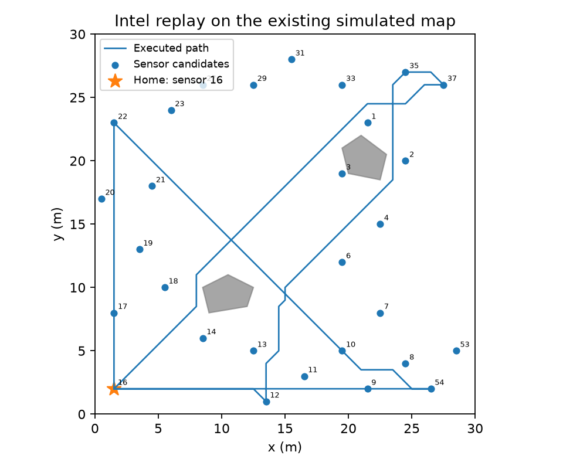
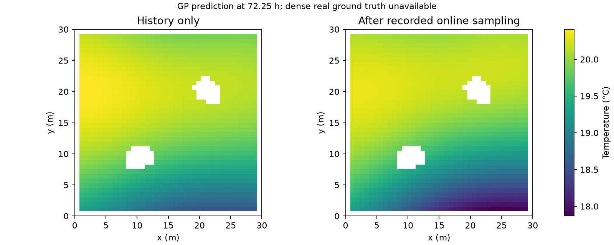
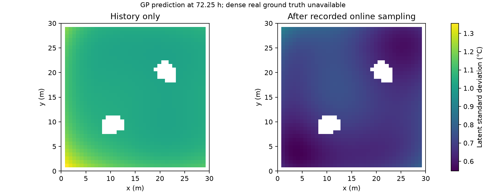
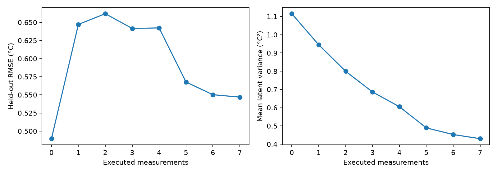

# Intel Lab: GP-GRG baseline replay

## Conditions

[Intel Lab repository](https://github.com/linsea423/Intel_Lab_Data); [original dataset](https://db.csail.mit.edu/labdata/labdata.html). Pinned commit: `f46a8102e0ae93c98969e919c0b68897a202e0f3`.

Training: 2004-02-29 to 2004-03-02, inclusive. Test: 2004-03-03. Time zero is 2004-02-29 00:00; original timezone is unspecified. Training spans [0,72) h; test spans [72,96) h.

Select exactly 2,000 actual observations: 667/667/666 per day. Within each day, allocate near-equal quotas across available sensors and choose distinct records nearest equally spaced time targets. Seed 18 assigns remainder quotas. Training covers 53 sensors. The cleaned training pool has 280,944 rows; the complete cleaned test day has 90,690 rows from 52 sensors. Keep original record IDs and acquisition times.

Apply a fixed 0 to 50 C indoor plausibility screen, require known coordinates and finite temperature, and preserve empty fields when parsing. This excludes 151 historical and 205 test temperature rows; 40 additional window rows lack sensor/temperature values. This screen is a documented preprocessing assumption, not proof of sensor accuracy. No imputation or temperature interpolation is used. The fourth-day labels never select hyperparameters, normalization, or training checkpoints.

Reuse the existing ConstantMean + 3D ARD RBF Exact GP, CPU float64, 300 Adam steps, and existing initialization/settings. The fit learns mean, lengthscales, output variance and likelihood noise. No synthetic noise is added to real records. Observation intervals include learned likelihood noise. All depths share the identical saved initial GP and 2,000-row history.

The user authorized moving Home to the nearest reachable sensor: sensor 16 at (1.5,2) m. Keep the existing 30 x 30 m map, two synthetic obstacles, footprint, 0.5 m navigation grid, 0.35 m/s speed, 5 s dwell, depth-2 default and 900 s budget. This is a replay on a simulated navigation map, not a reconstruction of laboratory navigation geometry.

Use the 29 real sensor coordinates that are footprint-reachable on this map. The other 23 valid test sensors are outside or unreachable. Replacing the original 48 synthetic candidate locations is necessary for real-record replay and was explicitly agreed. Home sampling and spatial revisits remain enabled.

Sort each test sensor's records by time. Even-indexed records form the acquisition pool; odd-indexed records form a disjoint evaluation pool. This split uses time/order only. GRG can see acquisition timestamps to estimate availability but never future temperature values. On arrival, wait for the next available record, acquire it at its actual timestamp, then consume 5 s dwell. The same raw record cannot be consumed twice. Consecutive sampling is permitted; the record schedule determines acquisition delay.

Mission time = travel + acquisition waiting + dwell + online computation. Waiting is included in the logged sampling component; computation remains 0 s in the mission clock. Measured GRG wall time remains a separate diagnostic. No active wait action, revisit interval or retry limit was added.

## Reconstruction reference

Target grid: same 0.75 m spacing and accessible map domain, now at day-4 target 72.25 h. Dense maps show GP predictions and latent uncertainty only; no real dense-grid truth is available.

RMSE uses 28 fixed held-out real records, one per available sensor where a reference exists in the five minutes before 72.25 h. Their actual timestamps span 72.199632 to 72.249560 h. These are not simultaneous dense-field truth. The final posterior may use online samples later than some reference records, so this is retrospective reconstruction; the separate forecast experiment tests future prediction without online data.

## Results

| Item | Result |
|---|---|
| Measurements | 7 |
| Planning calls | 8 |
| Returned Home | True |
| Mission time (s) | 870.259 |
| Acquisition waiting (s) | 368.148 |
| Dwell (s) | 35 |
| Initial held-out RMSE (C) | 0.489578 |
| Final held-out RMSE (C) | 0.546907 |
| Executed joint MI (nats) | 2.15273 |

All saved replay acceptance checks are in `verification.json`. Lower RMSE is a performance outcome, not a correctness requirement. Sampling-point MI remains the planning objective; the held-out reconstruction targets do not influence route selection.

## Figures

