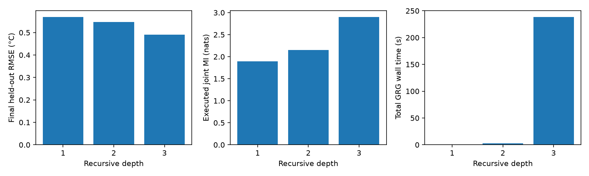

# Intel Lab: recursive-depth benchmark

Use the three-day 2,000-record GP and fourth-day replay described in [baseline report](../../baseline/intel_lab/replay/report.md). Test depths 1, 2 and 3 with identical history, checkpoint, candidates, Home, map, record availability, evaluation records and mission budget. Do not run depth 5.

| Depth | Status | Samples | Final RMSE (C) | MI (nats) | GRG wall time (s) |
|---|---|---|---|---|---|
| 1 | SUCCESS | 6 | 0.569799 | 1.89694 | 0.022234 |
| 2 | SUCCESS | 7 | 0.546907 | 2.15273 | 2.9357 |
| 3 | SUCCESS | 12 | 0.490406 | 2.90277 | 238.624 |

An external watchdog limits each planning call to 90 s and each mission worker to 900 s wall time. These are runtime bounds, not simulated mission charges. Timeouts and unattempted missions are reported as such. The paired depth-2 repeat checks deterministic observations, routes, times and metrics. There is one fixed real dataset, not multiple independent stochastic trials; no statistical significance or global-optimality claim is made.

Setup failures, if present in `failed_attempts/`, preserve failed serialization attempts. The corrected runs are reported above. They are not planner correctness failures.

