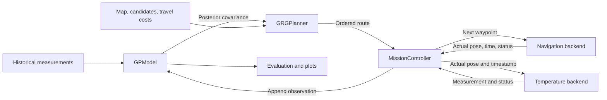

# 10.18 — 3D GP + GRG closed-loop simulation

## Question and objective

Can the existing 3D GP and GRG support a complete sampling mission? Validate posterior conditioning, time-aware planning, safe navigation, and return-home feasibility. Measure reconstruction changes at a fixed target time. This test does not compare planners.

## System logic

History → GP training → GRG route → execute next waypoint → measure at actual arrival → update GP posterior → replan → return home → evaluate.

Use 100 historical samples from 0–12 h. Start at 12 h and allow 900 s. Evaluate at 12.25 h. Use the existing synthetic field and RBF kernel. Freeze GP parameters and normalization during the mission. Synthetic measurement noise is zero; GP likelihood noise remains positive.

The map is 30 × 30 m with two obstacles. Navigation uses a 0.5 m grid and 0.35 m/s speed. The 0.6 × 0.4 m footprint uses a circumscribed circle plus a 0.1 m margin. There are 48 candidate nodes, including home. Each sample requires 5 s of dwell time after arrival.

## Mathematical architecture

### Temperature model and historical training

Let $z=(x,y,t)$, where position is in metres and time is in hours. The latent temperature is $f(z)$ in °C. A measurement is $Y_i=f(z_i)+\epsilon_i$, with independent $\epsilon_i\sim\mathcal{N}(0,\sigma_n^2)$.

The GP uses a constant mean and a 3D ARD RBF kernel:

$$
f(z)\sim\operatorname{GP}(m,k_\theta(z,z')),\qquad
k_\theta(z,z')=\sigma_f^2\exp\left[-\frac12\left(
\frac{(x-x')^2}{\ell_x^2}+\frac{(y-y')^2}{\ell_y^2}+\frac{(t-t')^2}{\ell_t^2}
\right)\right].
$$

Train on historical data $D_0=(X_0,Y_0)$ with $t_i\leq12$ h. Adam maximizes the log marginal likelihood:

$$
\theta^*=\arg\max_\theta\log\mathcal{N}\!\left(Y_0;m_0,K_{00}+\sigma_n^2I\right).
$$

Here $\theta$ includes the three lengthscales, signal variance, mean, and noise variance. The configured fit uses 300 steps. Input and temperature normalization are fitted on history only. The model is trained in normalized units; predictions and covariance are converted back to °C and °C². The kernel above can also be expressed in physical units using the converted parameters.

### Posterior prediction and online conditioning

After $k$ successful online measurements, the available dataset is $D_k=D_0\cup\{d_1,\ldots,d_k\}$. Write its inputs and values as $X,Y$, and define $C=K_{XX}+\sigma_n^2I$. For query inputs $Q$:

$$
\mu_Q=m_Q+K_{QX}C^{-1}(Y-m_X),\qquad
\Sigma_Q=K_{QQ}-K_{QX}C^{-1}K_{XQ}.
$$

$\mu_Q$ is the predicted temperature. $\Sigma_Q$ is the joint latent posterior covariance. Its diagonal gives marginal variance; its off-diagonal entries describe correlations between queries. Future noisy observations have covariance $\Sigma_Q+\sigma_n^2I$.

Each valid arrival measurement is appended to $D_k$. Kernel, mean, noise, and normalization remain fixed. Only the conditioning dataset changes. Cholesky factorization and triangular solves implement the formulas without explicit matrix inverses. The batched GRG evaluator uses the same fitted model and is checked against GPyTorch.

### Route timing and information gain

For a route $P=(v_0,v_1,\ldots,v_r,h)$, $v_0$ is the current position and $h$ is home. Let $a_0$ be the current elapsed mission time, $d=5$ s the sampling duration, and $\tau(u,v)=L(u,v)/0.35$ the obstacle-aware travel time. Arrival times are:

$$
a_1=a_0+\tau(v_0,v_1),\qquad
a_j=a_{j-1}+d+\tau(v_{j-1},v_j)\quad(j\geq2).
$$

Each proposed observation uses $z_j=(x_j,y_j,12+a_j/3600)$. The measurement occurs at arrival; dwell time delays departure. Navigation uses seconds, while GP queries use hours.

GRG scores these ordered spatiotemporal queries $S(P)$ using:

$$
J(P\mid D_k)=\frac12\log\det\left(I+\frac{\Sigma_{S(P)S(P)\mid D_k}}{\sigma_n^2}\right).
$$

The covariance is conditioned on all available measurements. Correlation reduces the reward of redundant samples. Changing route order can change arrival times and the reward. With fixed parameters and measurement inputs, temperature values affect the posterior mean but not this covariance-based reward.

GRG recursively selects intermediate nodes and splits the time budget. Depth is 2, so one planned route contains at most three new samples. Two split deadlines are tested per recursive waypoint. A split is a deadline, not an instruction to wait. The search returns a feasible high-reward route within this configured search; global optimality and the old fixed-set approximation guarantee are not asserted. See the [code audit](10.18_result/code_audit.md).

### Mission constraints and feedback

A complete route must satisfy the following constraint, where $E(P)$ contains its consecutive travel legs:

$$
\sum_{(u,v)\in E(P)}\tau(u,v)+rd\leq900-a_0.
$$

This includes travel to every sample, sampling time, and the final return home. Before executing the next waypoint $v$, the controller also checks:

$$
\tau(v_0,v)+d+\tau(v,h)\leq\text{remaining budget}.
$$

Only the next sampling waypoint is executed. The controller reads actual position, arrival time, and navigation status. It accepts a matching valid measurement, updates the GP, and replans. Failed navigation produces no successful sample. When no feasible extra sample remains, the controller attempts the reserved return route.

### Reconstruction objective

Evaluate initial and final predictions at the same independent spatial grid and target time, $Q=\{(x_j,y_j,12.25)\}_{j=1}^M$. Report:

$$
\operatorname{RMSE}=\sqrt{\frac1M\sum_j(\mu_j-f_j)^2},\qquad
\overline{v}=\frac1M\sum_j[\Sigma_Q]_{jj}.
$$

Latent 95% coverage is the fraction of true values inside $\mu_j\pm1.96\sqrt{[\Sigma_Q]_{jj}}$. MAE and interval width are also saved. Truth is available only to the synthetic data backend and evaluation. Evaluation metrics do not influence GRG decisions. GRG optimizes sampled-point information; lower target-grid RMSE is measured separately.

## Software architecture

`experiment.py` assembles the components. `MissionController` owns the online sequence. GP and GRG receive measurement data, candidate coordinates, and travel costs. They do not depend on simulator internals or ROS message types.



| Module in `testing_code/` | Main input → output | Responsibility |
|---|---|---|
| `reuse.py`, `gp.py`: `GPModel` | Historical/online measurements → posterior mean and covariance | Import the unchanged 10.16 GP. Train once, append data, query, and save checkpoints. |
| `grg.py`: `GRGPlanner` | Posterior, candidates, travel matrix, state, budget → `Plan` | Search ordered routes. Return waypoint IDs, predicted arrivals, finish time, reward, and GP version. |
| `navigation.py`: `GridMap` | Polygons and footprint → reachable grid and candidates | Inflate obstacles. Check full path segments and prevent diagonal corner cutting. |
| `navigation.py`: `PythonNavigationSimulator` | Goal → `NavigationResult` and updated state | Follow Dijkstra paths at constant speed. Record position, orientation, time, and trajectory. |
| `temperature.py`: `SyntheticTemperatureSource` | Historical queries or actual arrival → `Measurement` | Query the existing synthetic field and apply configured measurement noise. |
| `interfaces.py` | Shared records and method contracts | Define backend-independent measurements, robot state, and navigation results. |
| `mission.py`: `MissionController` | GP, planner, navigation, sensor → mission logs and summary | Check return reserves, execute one waypoint, validate data, update, and replan. |
| `evaluate.py`, `plots.py` | GP predictions and separate truth → metrics and figures | Evaluate the fixed target after each update. Metrics are logged without steering the planner. |
| `experiment.py`, `run_suite.py` | Configuration and seeds → saved runs and verification | Assemble the experiment, run tests, and check reproducibility. |

The dense navigation grid and the 48-node planning set serve different purposes. Grid paths determine collision-free travel costs. GRG searches the smaller candidate set. Travel costs are precomputed for this static map. Online measurements remain separate from historical measurements in the saved files; the GP conditions on both.

## Replaceable components and future integration

The contracts in [interfaces.py](testing_code/interfaces.py) define the current boundary:

| Contract | Operations | Required data |
|---|---|---|
| `TemperatureSource` | `load_history()`, `measure(position, timestamp_h)` | `Measurement(x_m, y_m, t_h, temperature_c, source, status)` |
| `Navigation` | `get_robot_state()`, `estimate_travel_cost(start, goal)`, `navigate_to(goal)`, `wait(duration_s)` | Actual pose, elapsed time, status, distance, travel time, and executed path |

| Current component | Planned replacement | Integration requirements |
|---|---|---|
| `SyntheticTemperatureSource` | `RealTemperatureSource` | Load real history and receive sensor readings. Match acquisition timestamps to localized poses. Reject invalid or stale data. Keep temperature units, coordinate frame, and time origin consistent. |
| `PythonNavigationSimulator` | `Nav2Adapter`, first in Gazebo, then on WELL-E | Send goals and read actual localization and action status. Convert feedback into the existing records. Support failure, cancellation, and return-home handling. |
| Fixed grid and precomputed travel matrix | Robot map/costmap and updated travel estimates | Apply the real footprint and safety margin. Generate reachable candidates. Refresh travel costs when position or the environment changes. Nav2 goal submission alone does not provide an accurate arrival-time estimate. |
| Complete synthetic evaluation truth | Held-out real measurements | Evaluate at observed locations and times. Dense real-field error requires independent spatial reference data. |

The GP training, posterior formulas, GRG reward, and route search can remain the mathematical core. The controller's sequence can also be retained. Real integration will still require an asynchronous execution layer, sensor synchronization, and revised time reserves. Actual sampling duration, turning, localization error, and computation delay must be accounted for.

The current `measure(position, timestamp_h)` contract assumes a reading can be associated with that arrival event. A real backend must verify this association. If sensing occurs after a delay or over an averaging window, the measurement timestamp and controller timing need to represent that acquisition process.

The synthetic field remains a simulation-only backend. Real air and water temperatures should use separate models unless their relationship is explicitly modeled. Backend replacement is planned work; the present tests validate the Python implementations.

## Test goals and rubric

| Test | Pass condition |
|---|---|
| A: Environment and navigation | Valid obstacles, footprint clearance, reachable nodes, safe paths, correct travel time. |
| B: GP posterior | Agreement with analytical conditioning; fixed parameters; variance does not increase at fixed queries. |
| C: GP–GRG | Posterior-based reward; arrival-time sensitivity; feasible ordered routes; correct replanning inputs. |
| D: Full mission | At least three samples and replans; actual arrival data; no collision; return within 900 s. |
| E: Reconstruction | Same target coordinates, time, and truth; reproducible RMSE, MAE, variance, and latent 95% coverage. |
| F: Interfaces and failures | Failed navigation creates no measurement; invalid data, empty routes, and low budgets are handled. |

All correctness checks must pass. Lower final RMSE is desirable, not a correctness requirement. Coverage is diagnostic; it must be interpreted with interval width. The suite includes a repeated seed and two additional seeds.

## Run and files

From this folder, with `testing_code/requirements.txt` installed:

```bash
python testing_code/run_suite.py
python testing_code/experiment.py                 # Main mission only
python testing_code/build_report.py              # Refresh the results notebook
```

The existing environment is `../10.16_GP3D_baseline_test/10.16_testing_code/.venv/bin/python`.

- [10.18_test_report.ipynb](10.18_test_report.ipynb): executed result tables, checks, plots, and concise conclusions.
- `testing_code/`: source, configuration, tests, and report builder.
- `10.18_result/main/`: main data, trajectory, plans, checkpoints, metrics, and figures.
- `10.18_result/debug/`, `repeat/`, `seed_19/`, `seed_20/`: complete supporting runs.
- `10.18_result/verification/`: test logs, reproducibility checks, environment, and source hashes.
- `10.18_result/seed_summary.csv`: run summaries.

The simulator assumes constant speed and no turning cost. Compute time is measured separately from mission time. Real sensor timing, localization, dynamic obstacles, and Nav2 adapters remain future work.
